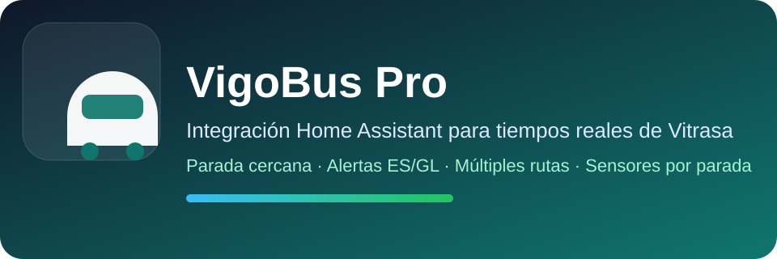

<p align="center"></p>

<p align="center">
  <a href="https://github.com/MUbeira0/vigobus-integration/blob/main/README.md">English</a> ·
  <b>Español</b> ·
  <a href="https://github.com/MUbeira0/vigobus-integration/blob/main/README.gl.md">Galego</a>
</p>

# VigoBus Pro

Integración de Home Assistant para los **autobuses urbanos de Vigo (Vitrasa)**: llegadas en tiempo real, tu parada más cercana, paradas extra, avisos de línea y planificador de viajes.

[](https://github.com/MUbeira0/vigobus-integration/releases)
[](https://www.home-assistant.io/)
[](https://www.home-assistant.io/integrations/marketplace/)

Tiene una tarjeta de dashboard complementaria: [lovelace-vigobus-card](https://github.com/MUbeira0/lovelace-vigobus-card).

## Qué ofrece

- **Llegadas en tiempo real** de cualquier parada de Vigo: línea, ruta, minutos, distancia del bus y si la estimación es en vivo (GPS) o de horario.
- **Parada más cercana** a tu casa, y **una por persona/móvil** que elijas (o de todos automáticamente).
- **Paradas extra**, cada una con filtro de línea opcional (por ejemplo solo la `C1`).
- **Avisos de línea** en castellano o gallego, con notificaciones opcionales.
- **Colores oficiales de línea** (campo `color` en cada bus) para que los dashboards coincidan con los autobuses reales.
- **Planificador de viajes** con transbordos, desde donde estás hasta una dirección o lugar (un colegio, un centro comercial, un hospital).
- Cada parada es un **dispositivo** de Home Assistant con sus 4 sensores agrupados.
- Fiabilidad: datos en caché, paradas actualizadas en paralelo, espera automática si los servidores de Vigo fallan y descarga de **diagnóstico** para reportar errores.

## Requisitos

- Home Assistant **2024.1.0 o superior** (las imágenes de marca se incluyen para 2026.3+).
- Acceso a internet a los servidores de datos abiertos de Vigo (`datos.vigo.org`).

## Instalación

Desde Home Assistant **2026.11**, HACS está integrado en Home Assistant como [Marketplace](https://www.home-assistant.io/integrations/marketplace/).

1. Abre el **Marketplace**, busca **VigoBus Pro** e instálalo.
2. Reinicia Home Assistant si te lo pide.

¿Ya lo tenías con HACS? No tienes que hacer nada: Home Assistant lo migra solo en el primer arranque de 2026.11 y sigue actualizándolo.

**Manual / Home Assistant anterior (con HACS):** añade `https://github.com/MUbeira0/vigobus-integration` como repositorio personalizado, categoría **Integración**, e instala **VigoBus Pro**.

## Configuración inicial

1. **Ajustes → Dispositivos y servicios → Añadir integración → VigoBus Pro.**
2. Elige cómo funciona la parada cercana de casa y el intervalo de actualización. El resto se puede cambiar después.
3. Añade más paradas desde **Configurar** (menú de la integración).

### Opciones de configuración

| Opción | Por defecto | Rango | Qué hace |
|---|---|---|---|
| Parada cercana automática | – | – | Crea los sensores de parada cercana según la ubicación de casa. |
| Nombre / filtro de línea de la parada cercana | vacío | – | Nombre personalizado y línea opcional (p. ej. `C1`). |
| Parada cercana para estos dispositivos | ninguno | – | Un conjunto de parada cercana por cada `person` / `device_tracker` que elijas. |
| Crear para todos los dispositivos | desactivado | – | Crea uno por cada dispositivo GPS automáticamente. |
| Intervalo de actualización | 30 s | 15–300 s | Cada cuánto se refrescan los sensores. |
| Distancia de recálculo | 120 m | 20–1000 m | Cuánto debe moverse un dispositivo para recalcular su parada cercana. |
| Avisos automáticos | desactivado | – | Avisa cuando un bus está a punto de llegar. |
| Umbral de aviso | 5 min | 1–60 | Avisa cuando el bus está a esta distancia en minutos. |
| Espera entre avisos | 20 min | 1–240 | Tiempo mínimo entre dos notificaciones. |
| Idioma de los avisos | `es` | `es` / `gl` | Idioma de los avisos de línea. |
| Máx. avisos por parada | 10 | 1–25 | Límite de avisos mostrados por parada. |
| Notificar cuando aparezca un aviso nuevo | desactivado | – | Lista opcional de servicios `notify` (p. ej. tu móvil), además del panel de notificaciones. |

**Configurar** tiene tres secciones (*Ubicación y parada cercana*, *Notificaciones*, *Avisos*) más **Añadir parada (buscar)**, **Añadir paradas (pegar lista)** y **Quitar parada**. La lista pegada es una línea con entradas separadas por ` | `, cada una `id,nombre,línea`, por ejemplo: `1234,Urzaiz,C1 | 5678,Colón`.

## Entidades

Cada parada (casa, extra o de dispositivo) es un dispositivo con cuatro sensores:

| Sensor | Estado |
|---|---|
| Parada principal | Minutos hasta el próximo bus (unidad `min`), con los detalles como atributos. |
| Línea | Línea del próximo bus. |
| Ruta | Ruta del próximo bus. |
| Próximos | Los siguientes buses de la parada. |

Los sensores por dispositivo tienen el atributo `is_device_nearest`, para que los dashboards los distingan. Puedes quitar el dispositivo de una parada desde la interfaz: si sigue configurada, vuelve en la siguiente recarga.

## Servicios

| Servicio | Qué hace |
|---|---|
| `vigobus.refresh` | Fuerza una actualización (`entry_id` opcional; por defecto todas). |
| `vigobus.nearest_stops` | Parada(s) más cercana(s) a `latitude` / `longitude` con sus buses y avisos. Opcional: `tie_margin_m` (60 por defecto), `max_candidates` (3), `line`, `lang`. |
| `vigobus.search_stops` | Busca paradas por nombre o id (`query`, `limit` opcional). |
| `vigobus.geocode` | Convierte una dirección o lugar en coordenadas (solo zona de Vigo) con OpenStreetMap Nominatim. |
| `vigobus.plan_trip` | Planifica un viaje en bus con transbordos usando el horario GTFS oficial de Vigo. |

Todos salvo `refresh` son **sin estado**: solo usan lo que les pasas y no guardan nada. Ejemplo:

```yaml
service: vigobus.plan_trip
data:
  origin_latitude: 42.2328
  origin_longitude: -8.7226
  destination_stop_id: "5557"
  depart_at: "18:00"      # vacío = ahora
  max_transfers: 2        # 0-2
  max_walk_m: 800         # 100-2000
  max_itineraries: 3      # 1-5
```

Origen y destino pueden ser coordenadas o un `stop_id` exacto (de `search_stops` / `nearest_stops`). El `ors_api_key` opcional hace que los tramos a pie del principio y del final sigan calles reales (clave gratuita en [openrouteservice.org](https://openrouteservice.org/dev), 2000 peticiones/día). Límites conocidos: solo el primer tramo en bus se contrasta con datos en vivo, y un viaje planificado justo pasada la medianoche puede perder un bus que empezó el día de servicio anterior.

## Privacidad

`vigobus.geocode` envía el texto que escribes al servicio público Nominatim de OpenStreetMap (aprox. 1 petición por segundo, en caché 1 hora). Los resultados deben atribuirse a *colaboradores de OpenStreetMap* donde se muestren. Nada más habla con terceros aparte de los datos abiertos de Vigo y, solo si lo configuras, OpenRouteService.

## Solución de problemas

- **No aparecen entidades tras instalar:** reinicia Home Assistant.
- **El icono o logo no se actualiza:** limpia la caché del navegador y recarga.
- **Los datos de una parada son incorrectos:** abre una incidencia con el id de la parada y la línea.
- **Reportar errores:** *Ajustes → Dispositivos y servicios → VigoBus Pro → Descargar diagnóstico*. El archivo oculta coordenadas y nombres de paradas personalizados.

## Desarrollo

```bash
pip install ruff pytest
ruff check custom_components/ tests/
pytest tests -q
```

El CI ejecuta Hassfest, validación HACS, lint y tests en cada push.

## Soporte

[Incidencias](https://github.com/MUbeira0/vigobus-integration/issues) · [Versiones](https://github.com/MUbeira0/vigobus-integration/releases)
