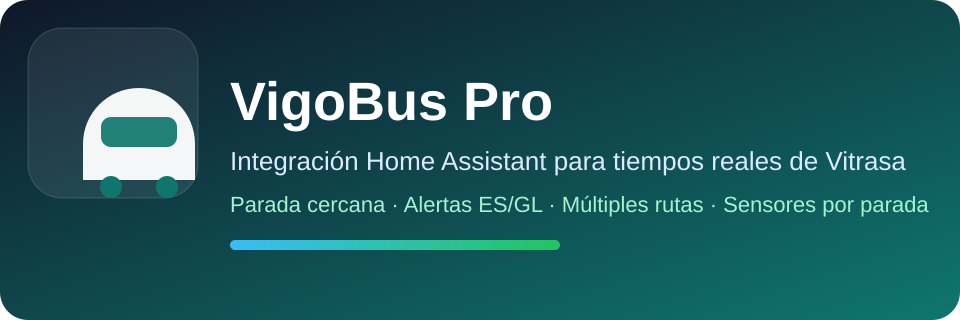

<p align="center"></p>

<p align="center">
  <a href="https://github.com/MUbeira0/vigobus-integration/blob/main/README.md">English</a> ·
  <a href="https://github.com/MUbeira0/vigobus-integration/blob/main/README.es.md">Español</a> ·
  <b>Galego</b>
</p>

# VigoBus Pro

Integración de Home Assistant para os **autobuses urbanos de Vigo (Vitrasa)**: chegadas en tempo real, a túa parada máis próxima, paradas extra, avisos de liña e planificador de viaxes.

[](https://github.com/MUbeira0/vigobus-integration/releases)
[](https://www.home-assistant.io/)
[](https://www.home-assistant.io/integrations/marketplace/)

Ten unha tarxeta de dashboard complementaria: [lovelace-vigobus-card](https://github.com/MUbeira0/lovelace-vigobus-card).

## Que ofrece

- **Chegadas en tempo real** de calquera parada de Vigo: liña, ruta, minutos, distancia do bus e se a estimación é en vivo (GPS) ou de horario.
- **Parada máis próxima** á túa casa, e **unha por persoa/móbil** que elixas (ou de todos automaticamente).
- **Paradas extra**, cada unha con filtro de liña opcional (por exemplo só a `C1`).
- **Avisos de liña** en castelán ou galego, con notificacións opcionais.
- **Cores oficiais de liña** (campo `color` en cada bus) para que os dashboards coincidan cos autobuses reais.
- **Planificador de viaxes** con transbordos, desde onde estás ata un enderezo ou lugar (un colexio, un centro comercial, un hospital).
- Cada parada é un **dispositivo** de Home Assistant cos seus 4 sensores agrupados.
- Fiabilidade: datos en caché, paradas actualizadas en paralelo, espera automática se os servidores de Vigo fallan e descarga de **diagnóstico** para reportar erros.

## Requisitos

- Home Assistant **2024.1.0 ou superior** (as imaxes de marca inclúense para 2026.3+).
- Acceso a internet aos servidores de datos abertos de Vigo (`datos.vigo.org`).

## Instalación

Desde Home Assistant **2026.11**, HACS está integrado en Home Assistant como [Marketplace](https://www.home-assistant.io/integrations/marketplace/).

1. Abre o **Marketplace**, busca **VigoBus Pro** e instálao.
2. Reinicia Home Assistant se o pide.

Xa o tiñas con HACS? Non tes que facer nada: Home Assistant migrao só no primeiro arranque de 2026.11 e segue actualizándoo.

**Manual / Home Assistant anterior (con HACS):** engade `https://github.com/MUbeira0/vigobus-integration` como repositorio personalizado, categoría **Integración**, e instala **VigoBus Pro**.

## Configuración inicial

1. **Axustes → Dispositivos e servizos → Engadir integración → VigoBus Pro.**
2. Elixe como funciona a parada próxima da casa e o intervalo de actualización. O resto pódese cambiar despois.
3. Engade máis paradas desde **Configurar** (menú da integración).

### Opcións de configuración

| Opción | Por defecto | Rango | Que fai |
|---|---|---|---|
| Parada próxima automática | – | – | Crea os sensores de parada próxima segundo a localización da casa. |
| Nome / filtro de liña da parada próxima | baleiro | – | Nome personalizado e liña opcional (p. ex. `C1`). |
| Parada próxima para estes dispositivos | ningún | – | Un conxunto de parada próxima por cada `person` / `device_tracker` que elixas. |
| Crear para todos os dispositivos | desactivado | – | Crea un por cada dispositivo GPS automaticamente. |
| Intervalo de actualización | 30 s | 15–300 s | Cada canto se refrescan os sensores. |
| Distancia de recálculo | 120 m | 20–1000 m | Canto debe moverse un dispositivo para recalcular a súa parada próxima. |
| Avisos automáticos | desactivado | – | Avisa cando un bus está a piques de chegar. |
| Límite de aviso | 5 min | 1–60 | Avisa cando o bus está a esta distancia en minutos. |
| Espera entre avisos | 20 min | 1–240 | Tempo mínimo entre dúas notificacións. |
| Idioma dos avisos | `es` | `es` / `gl` | Idioma dos avisos de liña. |
| Máx. avisos por parada | 10 | 1–25 | Límite de avisos amosados por parada. |
| Notificar cando apareza un aviso novo | desactivado | – | Lista opcional de servizos `notify` (p. ex. o teu móbil), ademais do panel de notificacións. |

**Configurar** ten tres seccións (*Localización e parada próxima*, *Notificacións*, *Avisos*) máis **Engadir parada (buscar)**, **Engadir paradas (pegar lista)** e **Quitar parada**. A lista pegada é unha liña con entradas separadas por ` | `, cada unha `id,nome,liña`, por exemplo: `1234,Urzaiz,C1 | 5678,Colón`.

## Entidades

Cada parada (casa, extra ou de dispositivo) é un dispositivo con catro sensores:

| Sensor | Estado |
|---|---|
| Parada principal | Minutos ata o próximo bus (unidade `min`), cos detalles como atributos. |
| Liña | Liña do próximo bus. |
| Ruta | Ruta do próximo bus. |
| Próximos | Os seguintes buses da parada. |

Os sensores por dispositivo teñen o atributo `is_device_nearest`, para que os dashboards os distingan. Podes quitar o dispositivo dunha parada desde a interface: se segue configurada, volve na seguinte recarga.

## Servizos

| Servizo | Que fai |
|---|---|
| `vigobus.refresh` | Forza unha actualización (`entry_id` opcional; por defecto todas). |
| `vigobus.nearest_stops` | Parada(s) máis próxima(s) a `latitude` / `longitude` cos seus buses e avisos. Opcional: `tie_margin_m` (60 por defecto), `max_candidates` (3), `line`, `lang`. |
| `vigobus.search_stops` | Busca paradas por nome ou id (`query`, `limit` opcional). |
| `vigobus.geocode` | Converte un enderezo ou lugar en coordenadas (só zona de Vigo) con OpenStreetMap Nominatim. |
| `vigobus.plan_trip` | Planifica unha viaxe en bus con transbordos usando o horario GTFS oficial de Vigo. |

Todos agás `refresh` son **sen estado**: só usan o que lles pasas e non gardan nada. Exemplo:

```yaml
service: vigobus.plan_trip
data:
  origin_latitude: 42.2328
  origin_longitude: -8.7226
  destination_stop_id: "5557"
  depart_at: "18:00"      # baleiro = agora
  max_transfers: 2        # 0-2
  max_walk_m: 800         # 100-2000
  max_itineraries: 3      # 1-5
```

Orixe e destino poden ser coordenadas ou un `stop_id` exacto (de `search_stops` / `nearest_stops`). O `ors_api_key` opcional fai que os treitos a pé do principio e do final sigan rúas reais (clave gratuíta en [openrouteservice.org](https://openrouteservice.org/dev), 2000 peticións/día). Límites coñecidos: só o primeiro treito en bus se contrasta con datos en vivo, e unha viaxe planificada xusto pasada a medianoite pode perder un bus que comezou o día de servizo anterior.

## Privacidade

`vigobus.geocode` envía o texto que escribes ao servizo público Nominatim de OpenStreetMap (aprox. 1 petición por segundo, en caché 1 hora). Os resultados deben atribuírse a *colaboradores de OpenStreetMap* onde se amosen. Nada máis fala con terceiros fóra dos datos abertos de Vigo e, só se o configuras, OpenRouteService.

## Solución de problemas

- **Non aparecen entidades tras instalar:** reinicia Home Assistant.
- **A icona ou logo non se actualiza:** limpa a caché do navegador e recarga.
- **Os datos dunha parada son incorrectos:** abre unha incidencia co id da parada e a liña.
- **Reportar erros:** *Axustes → Dispositivos e servizos → VigoBus Pro → Descargar diagnóstico*. O arquivo agocha coordenadas e nomes de paradas personalizados.

## Desenvolvemento

```bash
pip install ruff pytest
ruff check custom_components/ tests/
pytest tests -q
```

O CI executa Hassfest, validación HACS, lint e tests en cada push.

## Soporte

[Incidencias](https://github.com/MUbeira0/vigobus-integration/issues) · [Versións](https://github.com/MUbeira0/vigobus-integration/releases)
