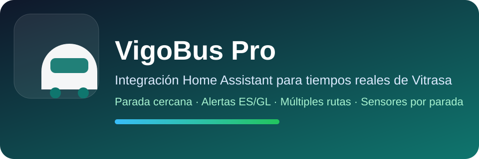

<p align="center"></p>

<p align="center"> <b>English</b> ·  <a href="#espanol">Español</a> ·  <a href="#galego">Galego</a><br><sub>Español y Galego están más abajo, en este mismo documento · Español e Galego están máis abaixo, neste mesmo documento</sub></p>

# VigoBus Pro

[](https://github.com/MUbeira0/vigobus-integration/releases)
[](https://www.home-assistant.io/)
[](https://www.home-assistant.io/integrations/marketplace/)

Home Assistant integration for the **urban buses of Vigo (Vitrasa)**: real-time arrivals, your nearest stop, extra stops, line alerts and a trip planner.


It has a companion dashboard card: [lovelace-vigobus-card](https://github.com/MUbeira0/lovelace-vigobus-card).

## What you get

- **Real-time arrivals** for any Vigo stop: line, route, minutes, distance of the bus, and whether the estimate is live (GPS) or timetable.
- **Nearest stop** to your home, plus **one per person/phone** you choose (or all of them automatically).
- **Extra stops**, each with an optional line filter (e.g. only line `C1`).
- **Line alerts** in Spanish or Galician, with optional notifications.
- **Official line colours** (`color` field on every bus) so dashboards can match the real buses.
- **Trip planner** with transfers, from where you are to an address or place (a school, a mall, a hospital).
- Every stop is a Home Assistant **device** with its 4 sensors grouped together.
- **Built for automations**: *Bus arriving* and *Leave now* sensors, an alerts event (new, started, ended), an alerts calendar, one binary sensor per alert kind (strike, closures, detours...), a service status sensor, commute profiles, ready-made blueprints and Assist voice commands (see *Automations*).
- Reliability: data is cached, stops refresh concurrently, it backs off if the Vigo servers are down, and it has a **diagnostics** download for bug reports.

## Requirements

- Home Assistant **2024.11.0 or newer** (brand images are bundled for 2026.3+).
- Internet access to the Vigo open-data servers (`datos.vigo.org`).

## Installation

Since Home Assistant **2026.11**, HACS is built into Home Assistant as the [Marketplace](https://www.home-assistant.io/integrations/marketplace/).

1. Open the **Marketplace**, search for **VigoBus Pro** and install it.
2. Restart Home Assistant if it asks you to.

Already installed with HACS? Nothing to do: Home Assistant migrates it automatically on the first start of 2026.11 and keeps updating it.

**Manual / older Home Assistant (with HACS):** add `https://github.com/MUbeira0/vigobus-integration` as a custom repository, category **Integration**, then install **VigoBus Pro**.

## Setup

1. **Settings → Devices & services → Add integration → VigoBus Pro.**
2. Choose how the home nearest stop works and the update interval. Everything else can be changed later.
3. Add more stops from **Configure** (menu of the integration).

### Setup and Configure options

| Option | Default | Range | What it does |
|---|---|---|---|
| Auto nearest stop | – | – | Creates the nearest-stop sensors from your home location. |
| Nearest stop name / line filter | empty | – | Custom name and optional line (e.g. `C1`). |
| Nearest stop for these devices | none | – | One nearest-stop set for each `person` / `device_tracker` you pick. |
| Auto-create for every device | off | – | Creates one for every GPS device automatically. |
| Update interval | 30 s | 15–300 s | How often sensors refresh. |
| Nearest recalc distance | 120 m | 20–1000 m | How far a device must move before its nearest stop is recomputed. |
| Nearest fallback radius | 250 m | 0–1500 m | How far beyond the closest stop to look for one with buses when the closest has none (0 = off). Also reported in `fallback_stop`; with no buses anywhere nearby, `no_service` lists the lines that serve the stop and the next scheduled departure. |
| Automatic alerts | off | – | Notify when a bus is about to arrive. |
| Alert threshold | 5 min | 1–60 | Notify when the bus is this close. |
| Alert cooldown | 20 min | 1–240 | Minimum time between two notifications. |
| Alerts language | `es` | `es` / `gl` | Language of the line alerts. |
| Max alerts per stop | 10 | 1–25 | Limit of alerts shown per stop. |
| Notify when a new alert appears | off | – | Optional list of `notify` services (e.g. your phone) in addition to the Home Assistant notification panel. |
| Bus arriving threshold | 5 min | 1–60 | The *Bus arriving* sensor is on when the next bus is this close. |
| Notify when it is time to leave | off | – | One notification when you should leave home to catch a bus (uses the walk time to the nearest stop). |
| Safety margin on the walk | 1 min | 0–15 | Extra minutes added to the walk for *Leave now*. |

**Configure** has three sections (*Location & nearest stop*, *Notifications*, *Alerts*) plus **Add stop (search)**, **Add stops (paste list)** and **Remove stop**. The pasted list is one line with entries separated by ` | `, each one `id,name,line`, for example: `1234,Urzaiz,C1 | 5678,Colón`.

## Entities

Each stop (home, extra or per-device) is a device with four sensors:

| Sensor | State |
|---|---|
| Main stop | Minutes until the next bus (unit `min`), with the details as attributes. |
| Line | Line of the next bus. |
| Route | Route of the next bus. |
| Upcoming | The next buses of the stop. |

Per-device sensors have the attribute `is_device_nearest`, so dashboards can tell them apart. Removing a stop's device from the UI is fine: if it is still configured, it comes back on the next reload.


If the closest stop has no buses at all at that moment, the nearest sensor shows the next closest stop (within 250 m of it) that does, and says so in its `fallback_stop` attribute, instead of staying on `unknown`. The closest stop is checked first on every scan.

## Automations

Everything below is meant to be used from automations, scripts and dashboards.

### Extra entities

Per stop (same device as its four sensors):

| Entity | What it is |
|---|---|
| **Bus arriving** (`binary_sensor`) | On while the next bus is at most N minutes away (set in *Configure → Notifications*). Attributes: `minutes`, `line`, `route`. |
| **Leave now** (`binary_sensor`, nearest stops only) | On when you should leave home to catch the next bus you can still reach. |
| **Leave in** (`sensor`, `min`, nearest stops only) | Minutes until you should leave (0 = now). Attributes: `walk_min`, `bus_minutes`, `line`, `missed_line`. |
| **Live reliability** (`sensor`, `%`, disabled by default) | Share of the listed buses that had a live GPS position over the last scans. |

For the whole integration (device *VigoBus servicio*):

| Entity | What it is |
|---|---|
| **Service status** (`sensor`) | `ok`, `alerts` (there are active line alerts), `degraded` (last scan failed) or `offline` (3 or more failed scans). |
| **Alerts** (`event`) | Fires `new_alert` once for every alert that was not there on the previous scan, with `id`, `title`, `lines`, `start`, `end`, `description`, `kind` and `status`. An alert is identified by its publication id, so an edited notice is not announced twice, and a feed outage never re-announces everything. Works even if notifications are off. Each alert is also fired as a `vigobus_new_alert` bus event, because an event entity only keeps the last one when several arrive in the same scan. |
| **Alert lifecycle** (`event`, same entity) | Besides `new_alert`, it fires `alert_started` when an upcoming alert comes into force and `alert_ended` when an alert is gone (after 3 good scans without it). Each one is also fired on the bus as `vigobus_alert_started` / `vigobus_alert_ended`. |
| **Alerts calendar** (`calendar`) | Each distinct alert as an all-day event from its start to its end date (title, description, lines and affected stops), so alerts show in the calendar view and can be used as calendar triggers. |
| **Alert kinds** (`binary_sensor`) | *strikes / road closures / detours / closed stops / roadworks in force*: on while at least one alert of that kind is in force on your stops. Attributes: `count`, `titles`, `lines`, `stops`. |
| **Commute \<name\>** (`sensor`) | Departure time of the best option for that commute, planned shortly before you usually leave. |

**How *Leave now* works.** The walk is the straight-line distance to the stop times 1.3 (streets are not straight) at 1.25 m/s, rounded up, plus your safety margin. The bus you can catch is the first one that is at least that far away. It is an estimate: it does not know about hills, crossings or your real walking speed.

### Commutes

*Configure → Add commute* lets you say "from home (or a person) to this stop, on these days, I usually leave at 08:15". Shortly before that time (20 minutes by default) VigoBus plans the best bus option, updates the *Commute* sensor and sends you a notification. It is planned once per day.

### Blueprints

Ready-made automations. They are installed for you in `config/blueprints/automation/vigobus/` every time the integration starts (Settings → Automations & scenes → Blueprints), or you can import them with a click. To customise one, copy it under another name: files with the VigoBus marker are refreshed on every start.

- [Do something when the bus is arriving](https://my.home-assistant.io/redirect/blueprint_import/?blueprint_url=https%3A%2F%2Fgithub.com%2FMUbeira0%2Fvigobus-integration%2Fblob%2Fmain%2Fcustom_components%2Fvigobus%2Fblueprints%2Fautomation%2Fvigobus%2Fbus_arriving_notify.yaml)
- [Do something when it is time to leave home](https://my.home-assistant.io/redirect/blueprint_import/?blueprint_url=https%3A%2F%2Fgithub.com%2FMUbeira0%2Fvigobus-integration%2Fblob%2Fmain%2Fcustom_components%2Fvigobus%2Fblueprints%2Fautomation%2Fvigobus%2Fleave_now_notify.yaml)
- [Do something when a new alert appears](https://my.home-assistant.io/redirect/blueprint_import/?blueprint_url=https%3A%2F%2Fgithub.com%2FMUbeira0%2Fvigobus-integration%2Fblob%2Fmain%2Fcustom_components%2Fvigobus%2Fblueprints%2Fautomation%2Fvigobus%2Fnew_alert_notify.yaml)
- [Announce the bus on a speaker](https://my.home-assistant.io/redirect/blueprint_import/?blueprint_url=https%3A%2F%2Fgithub.com%2FMUbeira0%2Fvigobus-integration%2Fblob%2Fmain%2Fcustom_components%2Fvigobus%2Fblueprints%2Fautomation%2Fvigobus%2Fannounce_bus_tts.yaml)

### Voice (Assist)

The integration registers the `VigoBusNextBus` intent and, every time it starts, copies its sentence files into `config/custom_sentences/` (`es`, `gl` and `en`) and reloads Assist, because Home Assistant only reads sentences from there. To customise them, copy a file under another name: files with the VigoBus marker are refreshed on every start. Then you can say, for example:

- "Cuándo pasa el bus" (your home stop)
- "Cuándo pasa el autobús por Urzaiz"
- "When does the next bus arrive at Urzaiz"

The answer is spoken in Spanish, Galician or English depending on the assistant's language. The sentences were checked against Home Assistant's sentence engine, but not yet with a real microphone and speaker.

### AI conversation agent (Ollama, OpenAI, Google...)

With a conversation agent that can use tools you can ask in natural language, for example "how long until the 25 gets to my stop?". VigoBus offers the agent a `vigobus__VigoBusNextBus` tool (Home Assistant 2026.x, where integrations declare their own tools) in two ways:

VigoBus registers its own API, **"VigoBus (solo autobuses)"** (version 2.19.5 or later; 2.19.4 failed when it was combined with other APIs). In the agent's settings pick it under **Control Home Assistant**:

- **Only buses** (recommended for small local models): select just "VigoBus (solo autobuses)". The prompt is only a couple of hundred tokens.
- **Buses and device control**: select "Device control" together with "VigoBus (solo autobuses)", and leave "Home Assistant" (full access) unselected. Device control sends the model every entity you exposed, which can be thousands of tokens. If it does not fit in the agent's context window the server cuts the prompt, the model loses the instructions and the tool's answer, and it calls the tool again and again (Ollama's log says `truncating input prompt`). Expose only the entities you need (Settings → Voice assistants → Expose) and size the context window to fit.

Keep **Prefer handling commands locally** on. Small local models (around 3B parameters) sometimes fill the tool wrongly, so VigoBus corrects the usual mistakes: a stop name written in the line field, "25 por casa" in the stop field, and "casa", "aquí" or "mi parada" meaning your home stop. Any stop in Vigo can be asked about, not only the configured ones, and waits of two hours or more are spoken in hours.

### Repairs and reconfiguring

- If a configured extra stop disappears from Vigo's stop list, Home Assistant shows a **Repair** (Settings → System → Repairs) that removes it with one click. It never raises it if the list could not be downloaded.
- **Reconfigure** (the entry menu in Devices & services) lets you change where the nearest stops come from and the update interval without removing the integration.

## Services

| Service | What it does |
|---|---|
| `vigobus.refresh` | Forces a refresh (optional `entry_id`; by default all entries). |
| `vigobus.nearest_stops` | Closest stop(s) to given `latitude` / `longitude` with their buses and alerts. Optional: `tie_margin_m` (default 60), `max_candidates` (3), `line`, `lang`. |
| `vigobus.search_stops` | Finds stops by name or id (`query`, optional `limit`). |
| `vigobus.geocode` | Turns an address or place into coordinates (Vigo area only) using OpenStreetMap Nominatim. |
| `vigobus.plan_trip` | Plans a bus trip with transfers using Vigo's official GTFS schedule. |

All services except `refresh` are **stateless**: they only use what you pass in and store nothing. Example:

```yaml
service: vigobus.plan_trip
data:
  origin_latitude: 42.2328
  origin_longitude: -8.7226
  destination_stop_id: "5557"
  depart_at: "18:00"      # empty = now
  max_transfers: 2        # 0-2
  max_walk_m: 800         # 100-2000
  max_itineraries: 3      # 1-5
```

Origin and destination can be coordinates or an exact `stop_id` (from `search_stops` / `nearest_stops`). Optional `ors_api_key` makes the first and last walking legs follow real streets (free key at [openrouteservice.org](https://openrouteservice.org/dev), 2000 requests/day). Known limits: only the first bus leg is checked against live data, and a trip planned just after midnight may miss a bus that started the previous service day.

## Privacy

`vigobus.geocode` sends the text you type to OpenStreetMap's public Nominatim service (about 1 request per second, cached for 1 hour). Results must be credited to *OpenStreetMap contributors* wherever they are shown. Nothing else talks to third parties apart from Vigo's open data and, only if you set it, OpenRouteService.

## Troubleshooting

- **No entities after installing:** restart Home Assistant.
- **Icon or logo not updating:** clear the browser cache and reload.
- **A stop's data is wrong:** open an issue with the stop id and line.
- **Bug reports:** *Settings → Devices & services → VigoBus Pro → Download diagnostics*. The file hides coordinates and custom stop names.

## Development

```bash
pip install ruff pytest
ruff check custom_components/ tests/
pytest tests -q
```

CI runs Hassfest, HACS validation, lint and tests on every push.

## Support

[Issues](https://github.com/MUbeira0/vigobus-integration/issues) · [Releases](https://github.com/MUbeira0/vigobus-integration/releases)

---

<a id="espanol"></a>
<details>
<summary><h2> Español</h2></summary>

Integración de Home Assistant para los **autobuses urbanos de Vigo (Vitrasa)**: llegadas en tiempo real, tu parada más cercana, paradas extra, avisos de línea y planificador de viajes.


Tiene una tarjeta de dashboard complementaria: [lovelace-vigobus-card](https://github.com/MUbeira0/lovelace-vigobus-card).

## Qué ofrece

- **Llegadas en tiempo real** de cualquier parada de Vigo: línea, ruta, minutos, distancia del bus y si la estimación es en vivo (GPS) o de horario.
- **Parada más cercana** a tu casa, y **una por persona/móvil** que elijas (o de todos automáticamente).
- **Paradas extra**, cada una con filtro de línea opcional (por ejemplo solo la `C1`).
- **Avisos de línea** en castellano o gallego, con notificaciones opcionales.
- **Colores oficiales de línea** (campo `color` en cada bus) para que los dashboards coincidan con los autobuses reales.
- **Planificador de viajes** con transbordos, desde donde estás hasta una dirección o lugar (un colegio, un centro comercial, un hospital).
- Cada parada es un **dispositivo** de Home Assistant con sus 4 sensores agrupados.
- **Pensada para automatizaciones**: sensores *Bus llegando* y *Salir ya*, un evento de avisos (nuevo, en vigor, terminado), un calendario de avisos, un sensor binario por tipo de aviso (huelga, cortes, desvíos...), un sensor del estado del servicio, trayectos habituales, blueprints ya hechos y comandos de voz de Assist (ver *Automatizaciones*).
- Fiabilidad: datos en caché, paradas actualizadas en paralelo, espera automática si los servidores de Vigo fallan y descarga de **diagnóstico** para reportar errores.

## Requisitos

- Home Assistant **2024.11.0 o superior** (las imágenes de marca se incluyen para 2026.3+).
- Acceso a internet a los servidores de datos abiertos de Vigo (`datos.vigo.org`).

## Instalación

Desde Home Assistant **2026.11**, HACS está integrado en Home Assistant como [Marketplace](https://www.home-assistant.io/integrations/marketplace/).

1. Abre el **Marketplace**, busca **VigoBus Pro** e instálalo.
2. Reinicia Home Assistant si te lo pide.

¿Ya lo tenías con HACS? No tienes que hacer nada: Home Assistant lo migra solo en el primer arranque de 2026.11 y sigue actualizándolo.

**Manual / Home Assistant anterior (con HACS):** añade `https://github.com/MUbeira0/vigobus-integration` como repositorio personalizado, categoría **Integración**, e instala **VigoBus Pro**.

## Configuración inicial

1. **Ajustes → Dispositivos y servicios → Añadir integración → VigoBus Pro.**
2. Elige cómo funciona la parada cercana de casa y el intervalo de actualización. El resto se puede cambiar después.
3. Añade más paradas desde **Configurar** (menú de la integración).

### Opciones de configuración

| Opción | Por defecto | Rango | Qué hace |
|---|---|---|---|
| Parada cercana automática | – | – | Crea los sensores de parada cercana según la ubicación de casa. |
| Nombre / filtro de línea de la parada cercana | vacío | – | Nombre personalizado y línea opcional (p. ej. `C1`). |
| Parada cercana para estos dispositivos | ninguno | – | Un conjunto de parada cercana por cada `person` / `device_tracker` que elijas. |
| Crear para todos los dispositivos | desactivado | – | Crea uno por cada dispositivo GPS automáticamente. |
| Intervalo de actualización | 30 s | 15–300 s | Cada cuánto se refrescan los sensores. |
| Distancia de recálculo | 120 m | 20–1000 m | Cuánto debe moverse un dispositivo para recalcular su parada cercana. |
| Radio de reserva de la cercana | 250 m | 0–1500 m | Hasta dónde buscar, más allá de la parada más cercana, una parada con buses cuando la más cercana no tiene ninguno (0 = desactivado). Se indica en `fallback_stop`; si no hay buses en ninguna cercana, `no_service` lista las líneas que sirven la parada y la próxima salida programada. |
| Avisos automáticos | desactivado | – | Avisa cuando un bus está a punto de llegar. |
| Umbral de aviso | 5 min | 1–60 | Avisa cuando el bus está a esta distancia en minutos. |
| Espera entre avisos | 20 min | 1–240 | Tiempo mínimo entre dos notificaciones. |
| Idioma de los avisos | `es` | `es` / `gl` | Idioma de los avisos de línea. |
| Máx. avisos por parada | 10 | 1–25 | Límite de avisos mostrados por parada. |
| Notificar cuando aparezca un aviso nuevo | desactivado | – | Lista opcional de servicios `notify` (p. ej. tu móvil), además del panel de notificaciones. |
| Umbral de bus llegando | 5 min | 1–60 | El sensor *Bus llegando* se activa cuando el próximo bus está así de cerca. |
| Avisar cuando toque salir | desactivado | – | Un aviso cuando debes salir de casa para coger un bus (usa el tiempo andando hasta la parada cercana). |
| Margen de seguridad al andar | 1 min | 0–15 | Minutos extra que se suman al paseo para *Salir ya*. |

**Configurar** tiene tres secciones (*Ubicación y parada cercana*, *Notificaciones*, *Avisos*) más **Añadir parada (buscar)**, **Añadir paradas (pegar lista)** y **Quitar parada**. La lista pegada es una línea con entradas separadas por ` | `, cada una `id,nombre,línea`, por ejemplo: `1234,Urzaiz,C1 | 5678,Colón`.

## Entidades

Cada parada (casa, extra o de dispositivo) es un dispositivo con cuatro sensores:

| Sensor | Estado |
|---|---|
| Parada principal | Minutos hasta el próximo bus (unidad `min`), con los detalles como atributos. |
| Línea | Línea del próximo bus. |
| Ruta | Ruta del próximo bus. |
| Próximos | Los siguientes buses de la parada. |

Los sensores por dispositivo tienen el atributo `is_device_nearest`, para que los dashboards los distingan. Puedes quitar el dispositivo de una parada desde la interfaz: si sigue configurada, vuelve en la siguiente recarga.


Si la parada más cercana no tiene ningún bus en ese momento, el sensor de parada cercana muestra la siguiente más cercana (a menos de 250 m de ella) que sí tenga, y lo indica en su atributo `fallback_stop`, en lugar de quedarse en `unknown`. En cada escaneo se prueba primero la más cercana.

## Automatizaciones

Todo lo de abajo está pensado para usarse desde automatizaciones, scripts y dashboards.

### Entidades extra

Por parada (en el mismo dispositivo que sus cuatro sensores):

| Entidad | Qué es |
|---|---|
| **Bus llegando** (`binary_sensor`) | Activo mientras el próximo bus está a N minutos o menos (se configura en *Configurar → Notificaciones*). Atributos: `minutes`, `line`, `route`. |
| **Salir ya** (`binary_sensor`, solo paradas cercanas) | Activo cuando debes salir de casa para coger el próximo bus que aún alcanzas. |
| **Salir en** (`sensor`, `min`, solo paradas cercanas) | Minutos hasta que debes salir (0 = ya). Atributos: `walk_min`, `bus_minutes`, `line`, `missed_line`. |
| **Fiabilidad en vivo** (`sensor`, `%`, desactivado por defecto) | Porcentaje de buses listados que tenían posición GPS en vivo durante los últimos escaneos. |

Para toda la integración (dispositivo *VigoBus servicio*):

| Entidad | Qué es |
|---|---|
| **Estado del servicio** (`sensor`) | `ok`, `alerts` (hay avisos de línea en vigor), `degraded` (el último escaneo falló) u `offline` (3 o más escaneos fallidos). Atributos: `active_alerts` y `upcoming_alerts` (avisos distintos, no uno por parada) y `alerts` con la lista sin duplicados y las paradas afectadas (`stops`). Los avisos caducados se descartan y los que aún no empiezan salen con `status: upcoming`. |
| **Avisos** (`event`) | Dispara `new_alert` una vez por cada aviso que no estaba en el escaneo anterior, con `id`, `title`, `lines`, `start`, `end`, `description`, `kind` y `status`. Un aviso se identifica por su id de publicación, así que uno editado no se anuncia dos veces, y una caída del servicio de avisos no vuelve a anunciarlos todos. Funciona aunque las notificaciones estén desactivadas. Cada aviso se lanza además como evento `vigobus_new_alert` en el bus, porque una entidad de evento solo conserva el último si llegan varios en el mismo escaneo. |
| **Ciclo de vida de los avisos** (`event`, misma entidad) | Además de `new_alert`, dispara `alert_started` cuando un aviso futuro entra en vigor y `alert_ended` cuando un aviso desaparece (tras 3 escaneos buenos sin verlo). Cada uno se lanza también en el bus como `vigobus_alert_started` / `vigobus_alert_ended`. |
| **Calendario de avisos** (`calendar`) | Cada aviso distinto como evento de día completo desde su inicio hasta su fin (título, descripción, líneas y paradas afectadas), para verlos en el calendario y usarlos como disparadores de calendario. |
| **Tipos de aviso** (`binary_sensor`) | *huelga / cortes de tráfico / desvíos / paradas anuladas / obras en vigor*: activo mientras haya al menos un aviso de ese tipo en vigor en tus paradas. Atributos: `count`, `titles`, `lines`, `stops`. |
| **Trayecto \<nombre\>** (`sensor`) | Hora de salida de la mejor opción de ese trayecto, planificada poco antes de que salgas. |

**Cómo funciona *Salir ya*.** El paseo es la distancia en línea recta a la parada por 1,3 (las calles no son rectas) a 1,25 m/s, redondeado hacia arriba, más tu margen de seguridad. El bus que puedes coger es el primero que está al menos a esa distancia. Es una estimación: no conoce cuestas, semáforos ni tu velocidad real.

### Trayectos

*Configurar → Añadir trayecto* te deja decir "desde casa (o una persona) hasta esta parada, estos días, suelo salir a las 08:15". Poco antes de esa hora (20 minutos por defecto) VigoBus planifica la mejor opción de bus, actualiza el sensor *Trayecto* y te envía una notificación. Se planifica una vez al día.

### Blueprints

Automatizaciones ya hechas. Se instalan solas en `config/blueprints/automation/vigobus/` cada vez que arranca la integración (Ajustes → Automatizaciones y escenas → Blueprints), o puedes importarlas con un clic. Para personalizar una, cópiala con otro nombre: los archivos con la marca de VigoBus se refrescan en cada arranque.

- [Hacer algo cuando llega el bus](https://my.home-assistant.io/redirect/blueprint_import/?blueprint_url=https%3A%2F%2Fgithub.com%2FMUbeira0%2Fvigobus-integration%2Fblob%2Fmain%2Fcustom_components%2Fvigobus%2Fblueprints%2Fautomation%2Fvigobus%2Fbus_arriving_notify.yaml)
- [Hacer algo cuando toca salir de casa](https://my.home-assistant.io/redirect/blueprint_import/?blueprint_url=https%3A%2F%2Fgithub.com%2FMUbeira0%2Fvigobus-integration%2Fblob%2Fmain%2Fcustom_components%2Fvigobus%2Fblueprints%2Fautomation%2Fvigobus%2Fleave_now_notify.yaml)
- [Hacer algo cuando aparece un aviso nuevo](https://my.home-assistant.io/redirect/blueprint_import/?blueprint_url=https%3A%2F%2Fgithub.com%2FMUbeira0%2Fvigobus-integration%2Fblob%2Fmain%2Fcustom_components%2Fvigobus%2Fblueprints%2Fautomation%2Fvigobus%2Fnew_alert_notify.yaml)
- [Anunciar el bus en un altavoz](https://my.home-assistant.io/redirect/blueprint_import/?blueprint_url=https%3A%2F%2Fgithub.com%2FMUbeira0%2Fvigobus-integration%2Fblob%2Fmain%2Fcustom_components%2Fvigobus%2Fblueprints%2Fautomation%2Fvigobus%2Fannounce_bus_tts.yaml)

### Voz (Assist)

La integración registra la intención `VigoBusNextBus` y, cada vez que arranca, copia sus archivos de frases en `config/custom_sentences/` (`es`, `gl` y `en`) y recarga Assist, porque Home Assistant solo lee las frases de ahí. Para personalizarlas, copia un archivo con otro nombre: los archivos con la marca de VigoBus se refrescan en cada arranque. Después puedes decir, por ejemplo:

- "Cuándo pasa el bus" (tu parada de casa)
- "Cuándo pasa el autobús por Urzaiz"
- "When does the next bus arrive at Urzaiz"

La respuesta se dice en castellano, gallego o inglés según el idioma del asistente. Las frases se comprobaron con el motor de frases de Home Assistant, pero todavía no con un micrófono y un altavoz reales.

### Agente de conversación con IA (Ollama, OpenAI, Google...)

Con un agente de conversación que pueda usar herramientas puedes preguntar con lenguaje natural, por ejemplo "cuánto tarda el 25 en llegar a mi parada". VigoBus le ofrece al agente una herramienta `vigobus__VigoBusNextBus` (Home Assistant 2026.x, donde las integraciones declaran sus propias herramientas) de dos formas:

VigoBus registra su propia API, **"VigoBus (solo autobuses)"** (versión 2.19.5 o posterior; la 2.19.4 fallaba al combinarla con otras APIs). En los ajustes del agente elígela en **Control Home Assistant**:

- **Solo autobuses** (recomendado para modelos locales pequeños): marca solo "VigoBus (solo autobuses)". El prompt son un par de cientos de tokens.
- **Autobuses y control de dispositivos**: marca "Control de dispositivos" junto con "VigoBus (solo autobuses)", y deja sin marcar "Home Assistant" (acceso completo). El control de dispositivos le manda al modelo todas las entidades que hayas expuesto, que pueden ser miles de tokens. Si no caben en la ventana de contexto del agente, el servidor recorta el prompt, el modelo pierde las instrucciones y la respuesta de la herramienta, y la llama una y otra vez (el registro de Ollama dice `truncating input prompt`). Expón solo las entidades que necesites (Ajustes → Asistentes de voz → Exponer) y ajusta la ventana de contexto.

Deja activado **Preferir gestionar comandos localmente**. Los modelos locales pequeños (de unos 3B) a veces rellenan mal la herramienta, así que VigoBus corrige los fallos habituales: un nombre de parada escrito en el campo de la línea, "25 por casa" en el campo de la parada, y "casa", "aquí" o "mi parada" como tu parada de casa. Se puede preguntar por cualquier parada de Vigo, no solo las configuradas, y las esperas de dos horas o más se dicen en horas.

### Reparaciones y reconfigurar

- Si una parada extra configurada desaparece de la lista de paradas de Vigo, Home Assistant muestra una **Reparación** (Ajustes → Sistema → Reparaciones) que la quita con un clic. Nunca se crea si no se pudo descargar la lista.
- **Reconfigurar** (el menú de la entrada en Dispositivos y servicios) te deja cambiar de dónde salen las paradas cercanas y el intervalo de actualización sin quitar la integración.

## Servicios

| Servicio | Qué hace |
|---|---|
| `vigobus.refresh` | Fuerza una actualización (`entry_id` opcional; por defecto todas). |
| `vigobus.nearest_stops` | Parada(s) más cercana(s) a `latitude` / `longitude` con sus buses y avisos. Opcional: `tie_margin_m` (60 por defecto), `max_candidates` (3), `line`, `lang`. |
| `vigobus.search_stops` | Busca paradas por nombre o id (`query`, `limit` opcional). |
| `vigobus.geocode` | Convierte una dirección o lugar en coordenadas (solo zona de Vigo) con OpenStreetMap Nominatim. |
| `vigobus.plan_trip` | Planifica un viaje en bus con transbordos usando el horario GTFS oficial de Vigo. |

Todos salvo `refresh` son **sin estado**: solo usan lo que les pasas y no guardan nada. Ejemplo:

```yaml
service: vigobus.plan_trip
data:
  origin_latitude: 42.2328
  origin_longitude: -8.7226
  destination_stop_id: "5557"
  depart_at: "18:00"      # vacío = ahora
  max_transfers: 2        # 0-2
  max_walk_m: 800         # 100-2000
  max_itineraries: 3      # 1-5
```

Origen y destino pueden ser coordenadas o un `stop_id` exacto (de `search_stops` / `nearest_stops`). El `ors_api_key` opcional hace que los tramos a pie del principio y del final sigan calles reales (clave gratuita en [openrouteservice.org](https://openrouteservice.org/dev), 2000 peticiones/día). Límites conocidos: solo el primer tramo en bus se contrasta con datos en vivo, y un viaje planificado justo pasada la medianoche puede perder un bus que empezó el día de servicio anterior.

## Privacidad

`vigobus.geocode` envía el texto que escribes al servicio público Nominatim de OpenStreetMap (aprox. 1 petición por segundo, en caché 1 hora). Los resultados deben atribuirse a *colaboradores de OpenStreetMap* donde se muestren. Nada más habla con terceros aparte de los datos abiertos de Vigo y, solo si lo configuras, OpenRouteService.

## Solución de problemas

- **No aparecen entidades tras instalar:** reinicia Home Assistant.
- **El icono o logo no se actualiza:** limpia la caché del navegador y recarga.
- **Los datos de una parada son incorrectos:** abre una incidencia con el id de la parada y la línea.
- **Reportar errores:** *Ajustes → Dispositivos y servicios → VigoBus Pro → Descargar diagnóstico*. El archivo oculta coordenadas y nombres de paradas personalizados.

## Desarrollo

```bash
pip install ruff pytest
ruff check custom_components/ tests/
pytest tests -q
```

El CI ejecuta Hassfest, validación HACS, lint y tests en cada push.

## Soporte

[Incidencias](https://github.com/MUbeira0/vigobus-integration/issues) · [Versiones](https://github.com/MUbeira0/vigobus-integration/releases)

</details>

<a id="galego"></a>
<details>
<summary><h2> Galego</h2></summary>

Integración de Home Assistant para os **autobuses urbanos de Vigo (Vitrasa)**: chegadas en tempo real, a túa parada máis próxima, paradas extra, avisos de liña e planificador de viaxes.


Ten unha tarxeta de dashboard complementaria: [lovelace-vigobus-card](https://github.com/MUbeira0/lovelace-vigobus-card).

## Que ofrece

- **Chegadas en tempo real** de calquera parada de Vigo: liña, ruta, minutos, distancia do bus e se a estimación é en vivo (GPS) ou de horario.
- **Parada máis próxima** á túa casa, e **unha por persoa/móbil** que elixas (ou de todos automaticamente).
- **Paradas extra**, cada unha con filtro de liña opcional (por exemplo só a `C1`).
- **Avisos de liña** en castelán ou galego, con notificacións opcionais.
- **Cores oficiais de liña** (campo `color` en cada bus) para que os dashboards coincidan cos autobuses reais.
- **Planificador de viaxes** con transbordos, desde onde estás ata un enderezo ou lugar (un colexio, un centro comercial, un hospital).
- Cada parada é un **dispositivo** de Home Assistant cos seus 4 sensores agrupados.
- **Pensada para automatizacións**: sensores *Bus chegando* e *Saír xa*, un evento de avisos (novo, en vigor, rematado), un calendario de avisos, un sensor binario por tipo de aviso (folga, cortes, desvíos...), un sensor do estado do servizo, traxectos habituais, blueprints xa feitos e comandos de voz de Assist (ver *Automatizacións*).
- Fiabilidade: datos en caché, paradas actualizadas en paralelo, espera automática se os servidores de Vigo fallan e descarga de **diagnóstico** para reportar erros.

## Requisitos

- Home Assistant **2024.11.0 ou superior** (as imaxes de marca inclúense para 2026.3+).
- Acceso a internet aos servidores de datos abertos de Vigo (`datos.vigo.org`).

## Instalación

Desde Home Assistant **2026.11**, HACS está integrado en Home Assistant como [Marketplace](https://www.home-assistant.io/integrations/marketplace/).

1. Abre o **Marketplace**, busca **VigoBus Pro** e instálao.
2. Reinicia Home Assistant se o pide.

Xa o tiñas con HACS? Non tes que facer nada: Home Assistant migrao só no primeiro arranque de 2026.11 e segue actualizándoo.

**Manual / Home Assistant anterior (con HACS):** engade `https://github.com/MUbeira0/vigobus-integration` como repositorio personalizado, categoría **Integración**, e instala **VigoBus Pro**.

## Configuración inicial

1. **Axustes → Dispositivos e servizos → Engadir integración → VigoBus Pro.**
2. Elixe como funciona a parada próxima da casa e o intervalo de actualización. O resto pódese cambiar despois.
3. Engade máis paradas desde **Configurar** (menú da integración).

### Opcións de configuración

| Opción | Por defecto | Rango | Que fai |
|---|---|---|---|
| Parada próxima automática | – | – | Crea os sensores de parada próxima segundo a localización da casa. |
| Nome / filtro de liña da parada próxima | baleiro | – | Nome personalizado e liña opcional (p. ex. `C1`). |
| Parada próxima para estes dispositivos | ningún | – | Un conxunto de parada próxima por cada `person` / `device_tracker` que elixas. |
| Crear para todos os dispositivos | desactivado | – | Crea un por cada dispositivo GPS automaticamente. |
| Intervalo de actualización | 30 s | 15–300 s | Cada canto se refrescan os sensores. |
| Distancia de recálculo | 120 m | 20–1000 m | Canto debe moverse un dispositivo para recalcular a súa parada próxima. |
| Radio de reserva da máis próxima | 250 m | 0–1500 m | Ata onde buscar, máis aló da parada máis próxima, unha parada con buses cando a máis próxima non ten ningún (0 = desactivado). Indícase en `fallback_stop`; se non hai buses en ningunha próxima, `no_service` lista as liñas que serven a parada e a próxima saída programada. |
| Avisos automáticos | desactivado | – | Avisa cando un bus está a piques de chegar. |
| Límite de aviso | 5 min | 1–60 | Avisa cando o bus está a esta distancia en minutos. |
| Espera entre avisos | 20 min | 1–240 | Tempo mínimo entre dúas notificacións. |
| Idioma dos avisos | `es` | `es` / `gl` | Idioma dos avisos de liña. |
| Máx. avisos por parada | 10 | 1–25 | Límite de avisos amosados por parada. |
| Notificar cando apareza un aviso novo | desactivado | – | Lista opcional de servizos `notify` (p. ex. o teu móbil), ademais do panel de notificacións. |
| Límite de bus chegando | 5 min | 1–60 | O sensor *Bus chegando* actívase cando o próximo bus está así de preto. |
| Avisar cando toque saír | desactivado | – | Un aviso cando debes saír da casa para coller un bus (usa o tempo andando ata a parada próxima). |
| Marxe de seguridade ao andar | 1 min | 0–15 | Minutos extra que se suman ao paseo para *Saír xa*. |

**Configurar** ten tres seccións (*Localización e parada próxima*, *Notificacións*, *Avisos*) máis **Engadir parada (buscar)**, **Engadir paradas (pegar lista)** e **Quitar parada**. A lista pegada é unha liña con entradas separadas por ` | `, cada unha `id,nome,liña`, por exemplo: `1234,Urzaiz,C1 | 5678,Colón`.

## Entidades

Cada parada (casa, extra ou de dispositivo) é un dispositivo con catro sensores:

| Sensor | Estado |
|---|---|
| Parada principal | Minutos ata o próximo bus (unidade `min`), cos detalles como atributos. |
| Liña | Liña do próximo bus. |
| Ruta | Ruta do próximo bus. |
| Próximos | Os seguintes buses da parada. |

Os sensores por dispositivo teñen o atributo `is_device_nearest`, para que os dashboards os distingan. Podes quitar o dispositivo dunha parada desde a interface: se segue configurada, volve na seguinte recarga.


Se a parada máis próxima non ten ningún bus nese momento, o sensor de parada próxima amosa a seguinte máis próxima (a menos de 250 m dela) que si o teña, e indícao no seu atributo `fallback_stop`, en vez de quedar en `unknown`. En cada escaneo próbase primeiro a máis próxima.

## Automatizacións

Todo o de abaixo está pensado para usarse desde automatizacións, scripts e dashboards.

### Entidades extra

Por parada (no mesmo dispositivo cos seus catro sensores):

| Entidade | Que é |
|---|---|
| **Bus chegando** (`binary_sensor`) | Activo mentres o próximo bus está a N minutos ou menos (configúrase en *Configurar → Notificacións*). Atributos: `minutes`, `line`, `route`. |
| **Saír xa** (`binary_sensor`, só paradas próximas) | Activo cando debes saír da casa para coller o próximo bus que aínda alcanzas. |
| **Saír en** (`sensor`, `min`, só paradas próximas) | Minutos ata que debes saír (0 = xa). Atributos: `walk_min`, `bus_minutes`, `line`, `missed_line`. |
| **Fiabilidade en vivo** (`sensor`, `%`, desactivado por defecto) | Porcentaxe de buses listados que tiñan posición GPS en vivo durante os últimos escaneos. |

Para toda a integración (dispositivo *VigoBus servicio*):

| Entidade | Que é |
|---|---|
| **Estado do servizo** (`sensor`) | `ok`, `alerts` (hai avisos de liña en vigor), `degraded` (o último escaneo fallou) ou `offline` (3 ou máis escaneos fallidos). Atributos: `active_alerts` e `upcoming_alerts` (avisos distintos, non un por parada) e `alerts` coa lista sen duplicados e as paradas afectadas (`stops`). Os avisos caducados descártanse e os que aínda non empezan saen con `status: upcoming`. |
| **Avisos** (`event`) | Dispara `new_alert` unha vez por cada aviso que non estaba no escaneo anterior, con `id`, `title`, `lines`, `start`, `end`, `description`, `kind` e `status`. Un aviso identifícase polo seu id de publicación, así que un editado non se anuncia dúas veces, e unha caída do servizo de avisos non volve anunciar todos. Funciona aínda que as notificacións estean desactivadas. Cada aviso lánzase ademais como evento `vigobus_new_alert` no bus, porque unha entidade de evento só conserva o último se chegan varios no mesmo escaneo. |
| **Ciclo de vida dos avisos** (`event`, mesma entidade) | Ademais de `new_alert`, dispara `alert_started` cando un aviso futuro entra en vigor e `alert_ended` cando un aviso desaparece (tras 3 escaneos bos sen velo). Cada un lánzase tamén no bus como `vigobus_alert_started` / `vigobus_alert_ended`. |
| **Calendario de avisos** (`calendar`) | Cada aviso distinto como evento de día completo desde o seu inicio ata o seu fin (título, descrición, liñas e paradas afectadas), para velos no calendario e usalos como disparadores de calendario. |
| **Tipos de aviso** (`binary_sensor`) | *folga / cortes de tráfico / desvíos / paradas anuladas / obras en vigor*: activo mentres haxa polo menos un aviso dese tipo en vigor nas túas paradas. Atributos: `count`, `titles`, `lines`, `stops`. |
| **Traxecto \<nome\>** (`sensor`) | Hora de saída da mellor opción dese traxecto, planificada pouco antes de que saias. |

**Como funciona *Saír xa*.** O paseo é a distancia en liña recta á parada por 1,3 (as rúas non son rectas) a 1,25 m/s, arredondado cara arriba, máis a túa marxe de seguridade. O bus que podes coller é o primeiro que está polo menos a esa distancia. É unha estimación: non coñece costas, semáforos nin a túa velocidade real.

### Traxectos

*Configurar → Engadir traxecto* déixache dicir "desde a casa (ou unha persoa) ata esta parada, estes días, adoito saír ás 08:15". Pouco antes desa hora (20 minutos por defecto) VigoBus planifica a mellor opción de bus, actualiza o sensor *Traxecto* e envíache unha notificación. Planifícase unha vez ao día.

### Blueprints

Automatizacións xa feitas. Instálanse soas en `config/blueprints/automation/vigobus/` cada vez que arranca a integración (Axustes → Automatizacións e escenas → Blueprints), ou podes importalas cun clic. Para personalizar unha, cópiaa con outro nome: os arquivos coa marca de VigoBus refréscanse en cada arranque.

- [Facer algo cando chega o bus](https://my.home-assistant.io/redirect/blueprint_import/?blueprint_url=https%3A%2F%2Fgithub.com%2FMUbeira0%2Fvigobus-integration%2Fblob%2Fmain%2Fcustom_components%2Fvigobus%2Fblueprints%2Fautomation%2Fvigobus%2Fbus_arriving_notify.yaml)
- [Facer algo cando toca saír da casa](https://my.home-assistant.io/redirect/blueprint_import/?blueprint_url=https%3A%2F%2Fgithub.com%2FMUbeira0%2Fvigobus-integration%2Fblob%2Fmain%2Fcustom_components%2Fvigobus%2Fblueprints%2Fautomation%2Fvigobus%2Fleave_now_notify.yaml)
- [Facer algo cando aparece un aviso novo](https://my.home-assistant.io/redirect/blueprint_import/?blueprint_url=https%3A%2F%2Fgithub.com%2FMUbeira0%2Fvigobus-integration%2Fblob%2Fmain%2Fcustom_components%2Fvigobus%2Fblueprints%2Fautomation%2Fvigobus%2Fnew_alert_notify.yaml)
- [Anunciar o bus nun altofalante](https://my.home-assistant.io/redirect/blueprint_import/?blueprint_url=https%3A%2F%2Fgithub.com%2FMUbeira0%2Fvigobus-integration%2Fblob%2Fmain%2Fcustom_components%2Fvigobus%2Fblueprints%2Fautomation%2Fvigobus%2Fannounce_bus_tts.yaml)

### Voz (Assist)

A integración rexistra a intención `VigoBusNextBus` e, cada vez que arranca, copia os seus arquivos de frases en `config/custom_sentences/` (`es`, `gl` e `en`) e recarga Assist, porque Home Assistant só le as frases de aí. Para personalizalas, copia un arquivo con outro nome: os arquivos coa marca de VigoBus refréscanse en cada arranque. Despois podes dicir, por exemplo:

- "Cando pasa o bus" (a túa parada da casa)
- "Cando chega o autobús en Urzaiz"
- "When does the next bus arrive at Urzaiz"

A resposta dise en castelán, galego ou inglés segundo o idioma do asistente. As frases comprobáronse co motor de frases de Home Assistant, pero aínda non cun micrófono e un altofalante reais.

### Axente de conversa con IA (Ollama, OpenAI, Google...)

Cun axente de conversa que poida usar ferramentas podes preguntar con linguaxe natural, por exemplo "canto tarda o 25 en chegar á miña parada". VigoBus ofrécelle ao axente unha ferramenta `vigobus__VigoBusNextBus` (Home Assistant 2026.x, onde as integracións declaran as súas propias ferramentas) de dúas formas:

VigoBus rexistra a súa propia API, **"VigoBus (solo autobuses)"** (versión 2.19.5 ou posterior; a 2.19.4 fallaba ao combinala con outras APIs). Nos axustes do axente elíxea en **Control Home Assistant**:

- **Só autobuses** (recomendado para modelos locais pequenos): marca só "VigoBus (solo autobuses)". O prompt son un par de centos de tokens.
- **Autobuses e control de dispositivos**: marca "Control de dispositivos" xunto con "VigoBus (solo autobuses)", e deixa sen marcar "Home Assistant" (acceso completo). O control de dispositivos mándalle ao modelo todas as entidades que expuxeses, que poden ser miles de tokens. Se non caben na xanela de contexto do axente, o servidor recorta o prompt, o modelo perde as instrucións e a resposta da ferramenta, e chámaa unha e outra vez (o rexistro de Ollama di `truncating input prompt`). Expón só as entidades que precises (Axustes → Asistentes de voz → Expoñer) e axusta a xanela de contexto.

Deixa activado **Preferir xestionar comandos localmente**. Os modelos locais pequenos (duns 3B) ás veces énchena mal, así que VigoBus corrixe os fallos habituais: un nome de parada escrito no campo da liña, "25 por casa" no campo da parada, e "casa", "aquí" ou "a miña parada" como a túa parada da casa. Pódese preguntar por calquera parada de Vigo, non só as configuradas, e as esperas de dúas horas ou máis dinse en horas.

### Reparacións e reconfigurar

- Se unha parada extra configurada desaparece da lista de paradas de Vigo, Home Assistant amosa unha **Reparación** (Axustes → Sistema → Reparacións) que a quita cun clic. Nunca se crea se non se puido descargar a lista.
- **Reconfigurar** (o menú da entrada en Dispositivos e servizos) déixache cambiar de onde saen as paradas próximas e o intervalo de actualización sen quitar a integración.

## Servizos

| Servizo | Que fai |
|---|---|
| `vigobus.refresh` | Forza unha actualización (`entry_id` opcional; por defecto todas). |
| `vigobus.nearest_stops` | Parada(s) máis próxima(s) a `latitude` / `longitude` cos seus buses e avisos. Opcional: `tie_margin_m` (60 por defecto), `max_candidates` (3), `line`, `lang`. |
| `vigobus.search_stops` | Busca paradas por nome ou id (`query`, `limit` opcional). |
| `vigobus.geocode` | Converte un enderezo ou lugar en coordenadas (só zona de Vigo) con OpenStreetMap Nominatim. |
| `vigobus.plan_trip` | Planifica unha viaxe en bus con transbordos usando o horario GTFS oficial de Vigo. |

Todos agás `refresh` son **sen estado**: só usan o que lles pasas e non gardan nada. Exemplo:

```yaml
service: vigobus.plan_trip
data:
  origin_latitude: 42.2328
  origin_longitude: -8.7226
  destination_stop_id: "5557"
  depart_at: "18:00"      # baleiro = agora
  max_transfers: 2        # 0-2
  max_walk_m: 800         # 100-2000
  max_itineraries: 3      # 1-5
```

Orixe e destino poden ser coordenadas ou un `stop_id` exacto (de `search_stops` / `nearest_stops`). O `ors_api_key` opcional fai que os treitos a pé do principio e do final sigan rúas reais (clave gratuíta en [openrouteservice.org](https://openrouteservice.org/dev), 2000 peticións/día). Límites coñecidos: só o primeiro treito en bus se contrasta con datos en vivo, e unha viaxe planificada xusto pasada a medianoite pode perder un bus que comezou o día de servizo anterior.

## Privacidade

`vigobus.geocode` envía o texto que escribes ao servizo público Nominatim de OpenStreetMap (aprox. 1 petición por segundo, en caché 1 hora). Os resultados deben atribuírse a *colaboradores de OpenStreetMap* onde se amosen. Nada máis fala con terceiros fóra dos datos abertos de Vigo e, só se o configuras, OpenRouteService.

## Solución de problemas

- **Non aparecen entidades tras instalar:** reinicia Home Assistant.
- **A icona ou logo non se actualiza:** limpa a caché do navegador e recarga.
- **Os datos dunha parada son incorrectos:** abre unha incidencia co id da parada e a liña.
- **Reportar erros:** *Axustes → Dispositivos e servizos → VigoBus Pro → Descargar diagnóstico*. O arquivo agocha coordenadas e nomes de paradas personalizados.

## Desenvolvemento

```bash
pip install ruff pytest
ruff check custom_components/ tests/
pytest tests -q
```

O CI executa Hassfest, validación HACS, lint e tests en cada push.

## Soporte

[Incidencias](https://github.com/MUbeira0/vigobus-integration/issues) · [Versións](https://github.com/MUbeira0/vigobus-integration/releases)

</details>
